<div align="center">


A pixel-styled [niri](https://github.com/YaLTeR/niri) desktop for Arch Linux.<br>
Every color comes from your wallpaper.

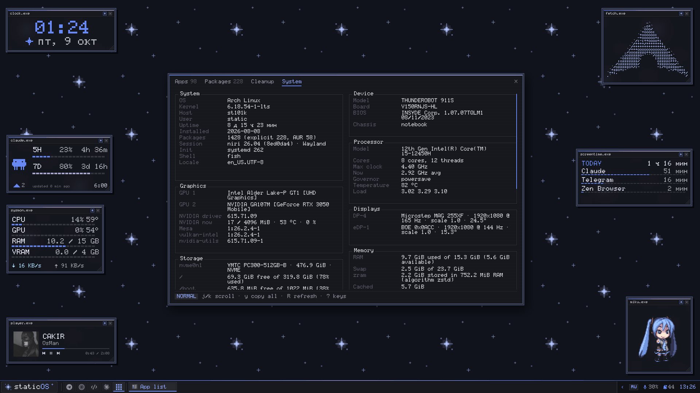


[Install](docs/install.md) · [User guide](docs/guide.md) · [Alarm](docs/alarm.md) · [Hub](docs/hub.md) · [Keybindings](docs/keybindings.md)

**English** · [Русский](README.ru.md)

</div>

> [!NOTE]
> Screenshots show demo data: a made-up alarm plan and no chats or notifications of anyone's.
> The windows are drawn by the same scripts that run on the desktop.

## Screenshots

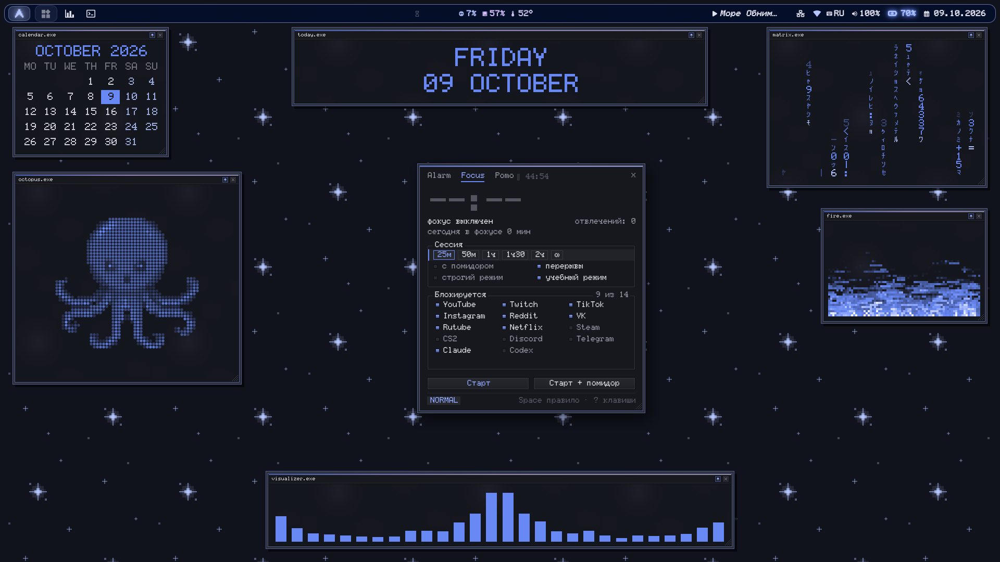

<p align="center"><i>With the top bar and Focus: block distracting sites and apps for a session.</i></p>

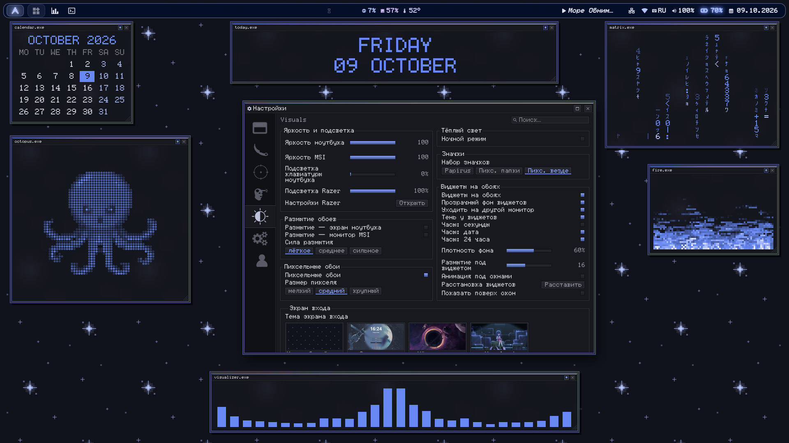

<p align="center"><i>Settings: one window for bars, fonts, widgets, lock screen and more.</i></p>

## Stack mode — `Ctrl+Shift+Super+M`

One key turns niri's scrolling columns into ordinary overlapping windows, the way most desktops
work, on every monitor at once. Press it again and every window goes back to its desk, column,
size and tab exactly as before; widgets keep working either way.

The bottom panel comes in two looks. Pick one in Settings → DE → Bottom panel look:

| Left sided | Centered minimal |
|:-:|:-:|
| 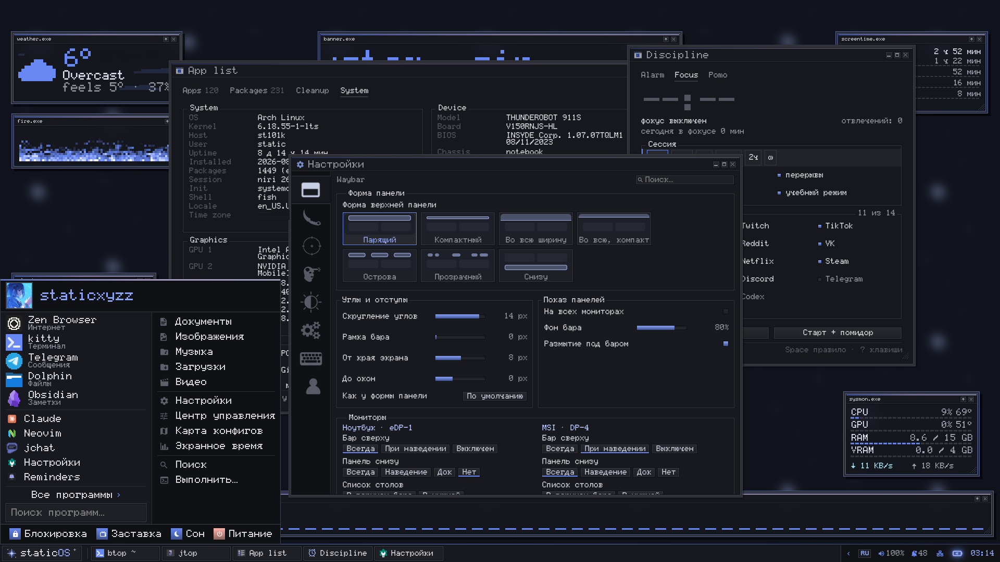 | 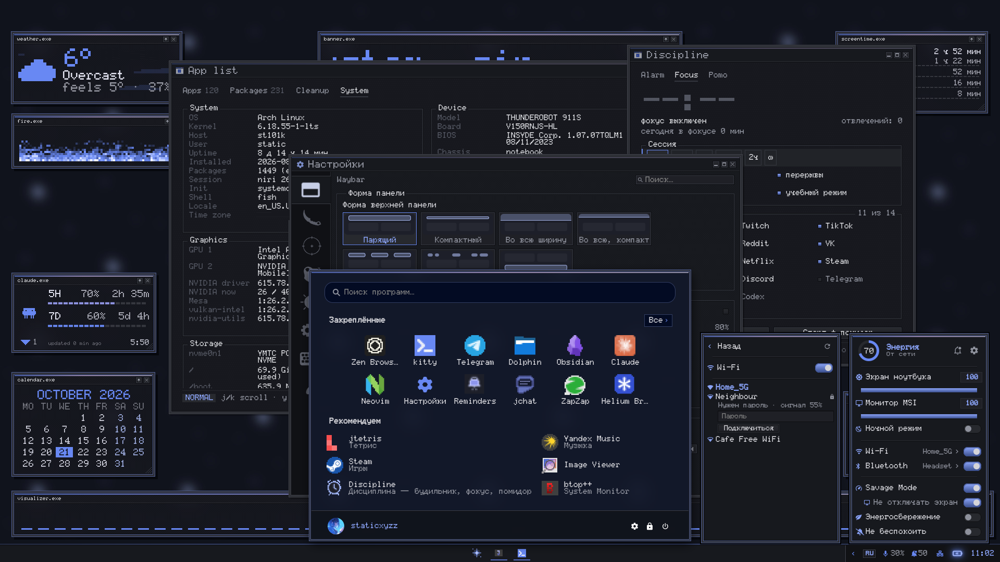 |
| XP-style taskbar: Start on the left, a button with a title for every window | Icons in the middle and a Windows 11-style Start |

- **Own title bars and frames** in the system style (Default, Skeet or Beta). Each bar has
  the app's own icon and minimize, maximize and close buttons.
  - Drag a window by its bar, also across monitors. Double-click maximizes it; middle-click
    minimizes it.
  - Resize a window by its edges.
  - The focused window casts a deeper shadow.
- **No buttons drawn twice.** staticOS windows, Telegram, Zen and Yandex Music hide their own
  title buttons while stack mode is on and get them back when it is off.
- **Left sided taskbar.** Minimized windows fly to their button and back.
  - Buttons can be dragged and pinned (right-click → Pin).
  - A pinned app stays as an icon when it has no window.
- **Centered minimal taskbar.** Icons sit in the middle of the panel. The Start menu is modeled on
  Windows 11 but kept compact.
  - The menu has search, a grid of pinned apps, recommended apps (the ones you used most this
    week) and an A–Z list of everything.
  - Behind the menu is a frosted, blurred copy of the wallpaper, and its frame follows the
    system style.
  - Keyboard: arrows or `Ctrl+H/J/K/L` to move, `Enter` to launch.
- **Settings follow the mode.** Options that only matter in stack mode show up only while it is on.
- **Keys:**
  - `Super+K` maximizes, or brings back the last minimized window.
  - `Super+J` minimizes.
  - `Super+H/L` go to the previous/next window, minimized ones included.
  - `Super+F` maximizes instead of going fullscreen.
  - `Super+D` minimizes all windows, or restores them.
  - Alt+Tab lists windows only.
- **While it is on:**
  - the top bar shows on hover;
  - the island sits under the windows;
  - window sounds play on minimize and maximize.

  All of this is remembered for the next time.

## Config map — `Super+Shift+Z`

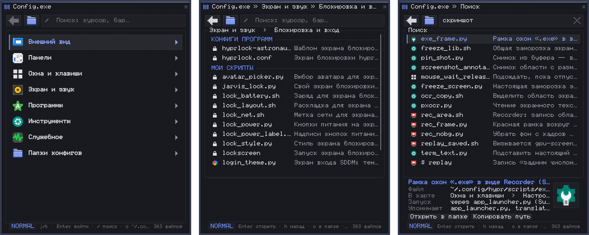

<p align="center"><i>Sections · inside an area: every file and what it does · search by name, description or synonym</i></p>

350+ scripts and configs, named over months, are hard to find your way around. The config map
tells you what each file does and what starts it, without opening anything.

- **Three levels instead of folders.** Eight sections (Look, Panels, Windows and keys, Screen
  and sound, Programs, Tools, System, Config folders) hold about twenty areas: top bar, wallpaper
  and colors, lock screen, sound, niri windows and so on. `Enter` goes one level deeper, `h` goes
  back, and the last `Enter` opens the file.
- **Remembers where you were.** Close the map and it opens on the same section, area, line and
  search next time.
- **The folder button follows you.** From the top level it opens `~/.config`; inside a section
  or an area it opens the folder where most of its files live (`c` does the same).
- **For each file:** what it does (from the file's own header), how it starts (key binding,
  niri autostart, bar module, systemd service, the staticOS host) and which scripts mention it.
- **Forgiving search.** Synonyms in both languages, typos and the wrong keyboard layout:
  `screenshot`, `скриншот` and `cybvjr` (typed on the English layout) all find «снимок»;
  `громкочть` still finds «громкость».
- **Vim keys:** `j/k`, `g/G`, `Ctrl+D/U`, `l`/`h`, `/` search, `o` folder, `y` copy path, `q` close.
  The × at the right of the search field (or `Ctrl+U`) clears the query.
- **Does not go stale.** `config_map.py check` lists files without an area and entries whose file
  is gone; `config_map.py md` writes the same map to `~/.config/0-КАРТА.md`.
  The scan is cached until a file changes, so the window opens in about a quarter of a second.

## Highlights

- **One palette everywhere.** Change the wallpaper and the bar, terminal, notifications,
  GTK/Qt apps, cursor, icons and even the keyboard backlight follow it.
- **Settings in one window** — `Super+/`. Bars, panels, fonts, lock screen, shaders, widgets,
  sounds: no config files to edit. Three looks: Default, Skeet, Beta.
- **An alarm you cannot sleep through.** It stops only when you type a phrase, checks on you
  again later, and a daytime Watchman keeps you from dozing off. [How it works →](docs/alarm.md)
- **Focus and pomodoro.** Block distracting sites and apps for a session, with a pomodoro on top.
- **Stack mode** — `Ctrl+Shift+Super+M`. Overlapping windows with title bars, frames and an
  a taskbar on every monitor (XP-style or centered with a Windows 11 Start); press again and
  everything returns to its columns.
- **App list** — `Super+Alt+T`. Programs and packages with versions, one-key rollback to an
  older version, hold, cleanup of package caches and logs, and a full system summary.
- **Desktop widgets and an XP-style taskbar.** Clocks, player, weather, system monitor and more
  as little `.exe` windows; an optional bottom panel with a Start button.
- **Screenshots, OCR and recording.** Annotate, pin a screenshot on top, copy text off the screen,
  record GIFs, videos and Telegram stickers.
- **Own clipboard, Alt+Tab, lock screen and screensaver**, all keyboard-driven with vim keys.
- **Pixel, regular or Minimalistic look** in one switch: fonts, bar, notifications, menus, mixers
  and even Discord follow it. Minimalistic is a centered capsule bar with thin borders and popups under it. **Super+Z** shows every shortcut, grouped and searchable.
- **Your own key bindings** — Settings → Binds. Press a new combination for any action; niri
  checks the config before anything is written, conflicts are named, and one click brings back
  the default (the bindings the dotfiles came with).
- **One menu at a time.** Opening `Super+X`, `Super+Z`, `Super+Shift+Z`, `Super+C` or `Super+W`
  closes whichever of them is already open. The small menus dim the screen behind them, and a
  click outside closes them.
- **Config map** — `Super+Shift+Z`. Which file does what and what starts it, with a search
  that understands synonyms, typos and the wrong keyboard layout. [See above ↑](#config-map--supershiftz)
- **`Super+X` menu** in the spirit of Omarchy: apps by category, screenshots and toggles,
  install / remove / update packages through fzf, system and power. Any site as its own
  window — `webapp add Name URL`.
- **Hub** — reminders, lists, timers and a spaced-repetition dictionary with no AI involved,
  its own SQLite database, a Discipline-styled window (`Super+M`) and an optional Telegram bot
  that reaches you when you're away from the computer. [How it works →](docs/hub.md)
- **Island** — a small capsule at the top centre: calls (with mute for the call only), recording,
  pomodoro, timers with 5–60 min presets, music with a pixel cover and a block equalizer, a
  pixel cat that runs while something is going on (and shows synced lyrics instead), snapshots.
  Hover or click opens a card, the wheel flips pages, it reopens on the page you left.
  System pages live right in the island: a control centre (night light, caffeine, power
  profile), Wi-Fi and Bluetooth lists with connect/forget and a password field, power buttons
  that ask before acting. File downloads show as a strip of filling squares, and «Back to
  work» types a reminder in the old-terminal way after a long stretch of video or dotfile
  tinkering. Settings → Waybar → Island: «As the system», Skeet or iOS look, thread brightness.

## More screenshots

| | |
|:-:|:-:|
|  | 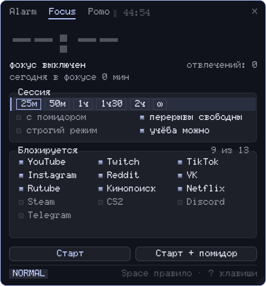 |
| Alarm plan for the week | Focus session |
| 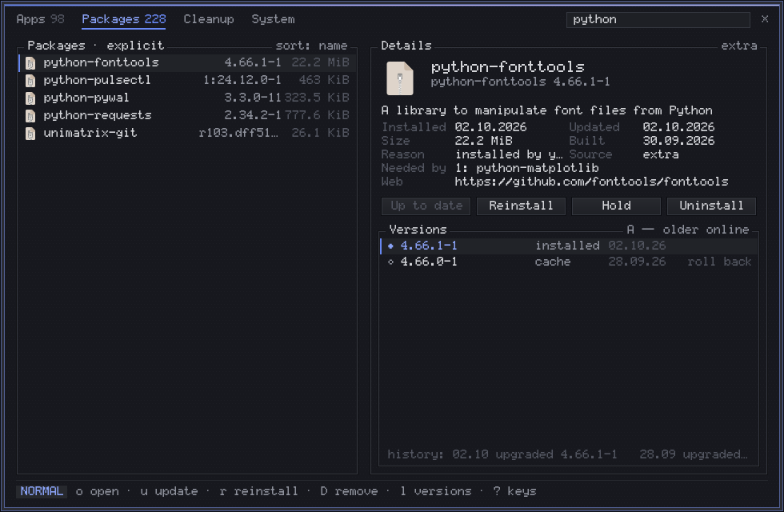 | 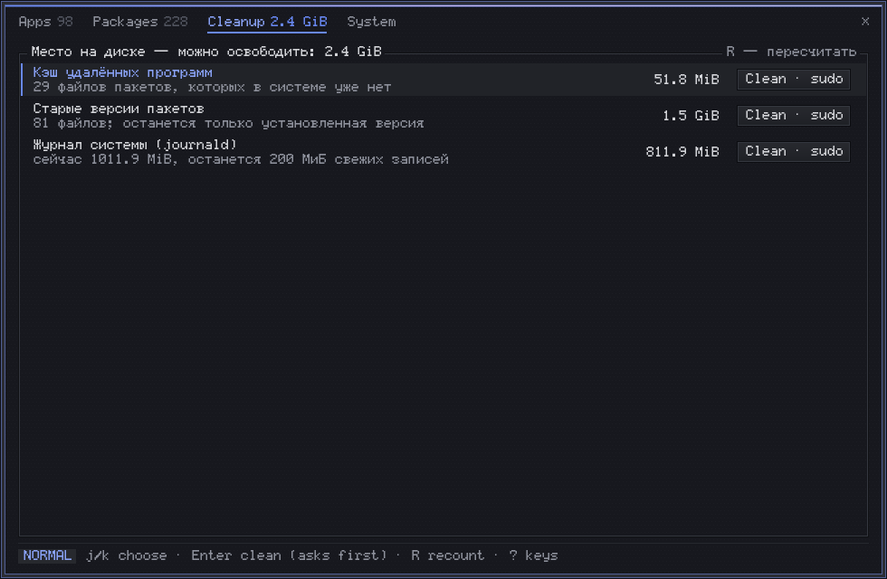 |
| Packages with roll back | Cleanup |

<details>
<summary>Three looks: Default, Skeet, Beta</summary>

| Default | Skeet | Beta |
|:-:|:-:|:-:|
|  | 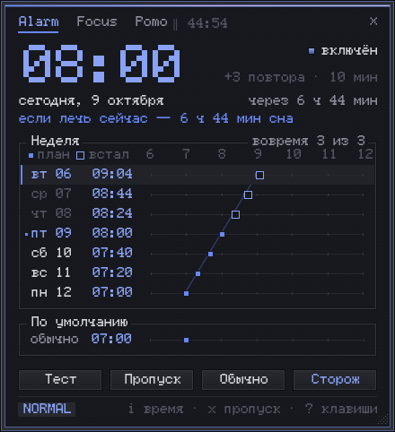 | 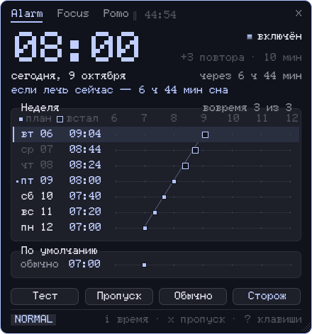 |

</details>

## Install

```sh
git clone https://github.com/staticxyz/staticos.git ~/staticos
cd ~/staticos && ./install.sh
```

Log out, choose **niri** on the login screen, log in. Your own files are backed up first.
`staticos-doctor` checks that nothing is missing.
Other distributions, options and removal: [docs/install.md](docs/install.md).

## First keys

| Keys | |
|---|---|
| `Super+/` | Settings |
| `Super+Z` | All shortcuts — cheat sheet with search |
| `Super+Shift+Z` | Config map: which file does what |
| `Super+X` | Menu: apps, actions, packages, system |
| `Super+Space` | Launch an app |
| `Super+Return` | Terminal |
| `Super+W` | Wallpaper (recolors everything) |
| `Super+Alt+F` | Alarm, focus, pomodoro |
| `Super+Alt+T` | App list |
| `Ctrl+Shift+Super+M` | Stack mode: overlapping windows on/off |
| `Super+Alt+V` | Clipboard |
| `Super+C` | Calculator and translator |
| `Super+Print` / `Shift+Print` | Annotated screenshot / copy text from screen |
| `Super+O` / `Alt+F4` | Lock / power menu |

Everything else is in the **[user guide](docs/guide.md)**.

## Notes

- The interface is in Russian; the docs are in English (the alarm guide also [in Russian](docs/ru/alarm.md)).
- No keys, tokens, passwords, browser profiles or personal state are in the repository.
- Scripts live in `~/.config/hypr/scripts` — the setup started on Hyprland and moved to niri.
- Windows XP sounds are not included. Put your own `.wav` files into
  `~/.config/hypr/sounds/xp/`; the retro set is generated during install.
- `fan`, `power`, `kbd_colors.py` and the Razer scripts target one specific laptop and keyboard.
  Elsewhere they do nothing.

## License

[MIT](LICENSE) © 2026 staticxyz. Bundled fonts keep their own licenses —
see [FONTS-LICENSE.md](.local/share/fonts/FONTS-LICENSE.md).
