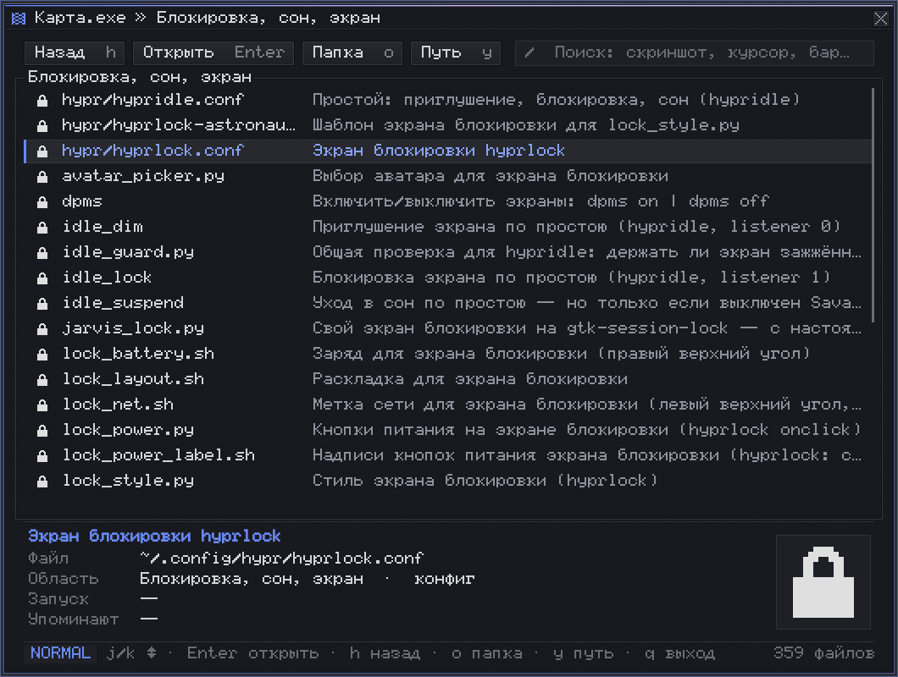
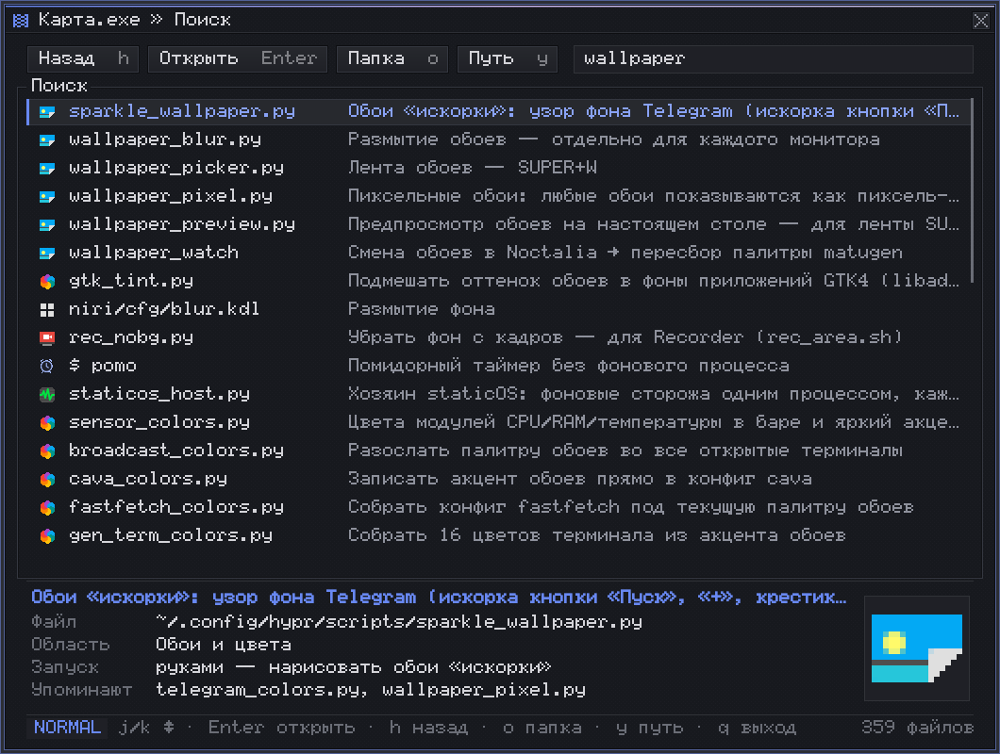

<div align="center">

# staticOS

A pixel-styled [niri](https://github.com/YaLTeR/niri) desktop for Arch Linux.<br>
Every color comes from your wallpaper.


[Install](docs/install.md) · [User guide](docs/guide.md) · [Alarm](docs/alarm.md) · [Hub](docs/hub.md) · [Keybindings](docs/keybindings.md)

**English** · [Русский](README.ru.md)

</div>

> [!NOTE]
> Screenshots show demo data: a made-up alarm plan and no chats or notifications of anyone's.
> The windows are drawn by the same scripts that run on the desktop.

## Screenshots


<p align="center"><i>With the top bar and Focus: block distracting sites and apps for a session.</i></p>


<p align="center"><i>Settings: one window for bars, fonts, widgets, lock screen and more.</i></p>

## Config map — `Super+Shift+Z`


350+ scripts and configs, named over months, are hard to find your way around. The config map
tells you what each file does and what starts it, without opening anything.

- **Three levels instead of folders.** Eight sections (Look, Panels, Windows and keys, Screen
  and sound, Programs, Tools, System, Config folders) hold about twenty areas: top bar, wallpaper
  and colors, lock screen, sound, niri windows and so on. `Enter` goes one level deeper, `h` goes
  back, and the last `Enter` opens the file.
- **Remembers where you were.** Close the map and it opens on the same section, area, line and
  search next time.
- **The folder button follows you.** From the top level it opens `~/.config`; inside a section
  or an area it opens the folder where most of its files live (`c` does the same).
- **For each file:** what it does (from the file's own header), how it starts (key binding,
  niri autostart, bar module, systemd service, the staticOS host) and which scripts mention it.
- **Forgiving search.** Synonyms in both languages, typos and the wrong keyboard layout:
  `screenshot`, `скриншот` and `cybvjr` (typed on the English layout) all find «снимок»;
  `громкочть` still finds «громкость».
- **Vim keys:** `j/k`, `g/G`, `Ctrl+D/U`, `l`/`h`, `/` search, `o` folder, `y` copy path, `q` close.
  The × at the right of the search field (or `Ctrl+U`) clears the query.
- **Does not go stale.** `config_map.py check` lists files without an area and entries whose file
  is gone; `config_map.py md` writes the same map to `~/.config/0-КАРТА.md`.
  The scan is cached until a file changes, so the window opens in about a quarter of a second.

| | |
|:-:|:-:|
|  |  |
| Inside an area: every file with what it does | Search by name, description or synonym |

## Highlights

- **One palette everywhere.** Change the wallpaper and the bar, terminal, notifications,
  GTK/Qt apps, cursor, icons and even the keyboard backlight follow it.
- **Settings in one window** — `Super+/`. Bars, panels, fonts, lock screen, shaders, widgets,
  sounds: no config files to edit. Three looks: Default, Skeet, Beta.
- **An alarm you cannot sleep through.** It stops only when you type a phrase, checks on you
  again later, and a daytime Watchman keeps you from dozing off. [How it works →](docs/alarm.md)
- **Focus and pomodoro.** Block distracting sites and apps for a session, with a pomodoro on top.
- **App list** — `Super+Alt+T`. Programs and packages with versions, one-key rollback to an
  older version, hold, cleanup of package caches and logs, and a full system summary.
- **Desktop widgets and an XP-style taskbar.** Clocks, player, weather, system monitor and more
  as little `.exe` windows; an optional bottom panel with a Start button.
- **Screenshots, OCR and recording.** Annotate, pin a screenshot on top, copy text off the screen,
  record GIFs, videos and Telegram stickers.
- **Own clipboard, Alt+Tab, lock screen and screensaver**, all keyboard-driven with vim keys.
- **Pixel, regular or Minimalistic look** in one switch: fonts, bar, notifications, menus, mixers
  and even Discord follow it. Minimalistic is a centered capsule bar with thin borders and popups under it. **Super+Z** shows every shortcut, grouped and searchable.
- **Your own key bindings** — Settings → Binds. Press a new combination for any action; niri
  checks the config before anything is written, conflicts are named, and one click brings back
  the default (the bindings the dotfiles came with).
- **One menu at a time.** Opening `Super+X`, `Super+Z`, `Super+Shift+Z`, `Super+C` or `Super+W`
  closes whichever of them is already open. The small menus dim the screen behind them, and a
  click outside closes them.
- **Config map** — `Super+Shift+Z`. Which file does what and what starts it, with a search
  that understands synonyms, typos and the wrong keyboard layout. [See above ↑](#config-map--supershiftz)
- **`Super+X` menu** in the spirit of Omarchy: apps by category, screenshots and toggles,
  install / remove / update packages through fzf, system and power. Any site as its own
  window — `webapp add Name URL`.
- **Hub** — reminders, lists, timers and a spaced-repetition dictionary with no AI involved,
  its own SQLite database, a Discipline-styled window (`Super+M`) and an optional Telegram bot
  that reaches you when you're away from the computer. [How it works →](docs/hub.md)

## More screenshots

| | |
|:-:|:-:|
|  |  |
| Alarm plan for the week | Focus session |
|  |  |
| Packages with roll back | Cleanup |

<details>
<summary>Three looks: Default, Skeet, Beta</summary>

| Default | Skeet | Beta |
|:-:|:-:|:-:|
|  |  |  |

</details>

## Install

```sh
git clone https://github.com/staticxyz/staticos.git ~/staticos
cd ~/staticos && ./install.sh
```

Log out, choose **niri** on the login screen, log in. Your own files are backed up first.
`staticos-doctor` checks that nothing is missing.
Other distributions, options and removal: [docs/install.md](docs/install.md).

## First keys

| Keys | |
|---|---|
| `Super+/` | Settings |
| `Super+Z` | All shortcuts — cheat sheet with search |
| `Super+Shift+Z` | Config map: which file does what |
| `Super+X` | Menu: apps, actions, packages, system |
| `Super+Space` | Launch an app |
| `Super+Return` | Terminal |
| `Super+W` | Wallpaper (recolors everything) |
| `Super+Alt+F` | Alarm, focus, pomodoro |
| `Super+Alt+T` | App list |
| `Super+Alt+V` | Clipboard |
| `Super+C` | Calculator and translator |
| `Super+Print` / `Shift+Print` | Annotated screenshot / copy text from screen |
| `Super+O` / `Alt+F4` | Lock / power menu |

Everything else is in the **[user guide](docs/guide.md)**.

## Notes

- The interface is in Russian; the docs are in English (the alarm guide also [in Russian](docs/ru/alarm.md)).
- No keys, tokens, passwords, browser profiles or personal state are in the repository.
- Scripts live in `~/.config/hypr/scripts` — the setup started on Hyprland and moved to niri.
- Windows XP sounds are not included. Put your own `.wav` files into
  `~/.config/hypr/sounds/xp/`; the retro set is generated during install.
- `fan`, `power`, `kbd_colors.py` and the Razer scripts target one specific laptop and keyboard.
  Elsewhere they do nothing.

## License

[MIT](LICENSE) © 2026 staticxyz. Bundled fonts keep their own licenses —
see [FONTS-LICENSE.md](.local/share/fonts/FONTS-LICENSE.md).
