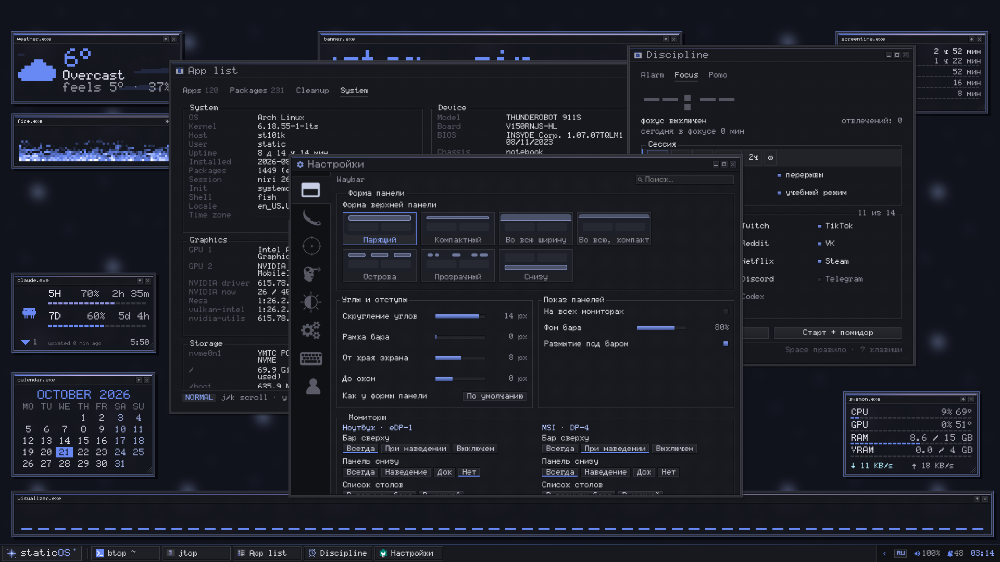

<div align="center">

# staticOS

Пиксельный рабочий стол на [niri](https://github.com/YaLTeR/niri) для Arch Linux.<br>
Все цвета берутся из обоев.


[Установка](docs/install.md) · [Руководство](docs/guide.md) · [Будильник](docs/ru/alarm.md) · [Hub](docs/ru/hub.md) · [Все клавиши](docs/ru/keybindings.md)

[English](README.md) · **Русский**

</div>

> [!NOTE]
> На снимках демо-данные: выдуманный план будильника, ничьих чатов и уведомлений.
> Окна отрисованы теми же скриптами, что работают на рабочем столе.

## Снимки


<p align="center"><i>С верхним баром и Focus: блокировка сайтов и программ на время сессии.</i></p>


<p align="center"><i>Настройки: панели, шрифты, виджеты, экран блокировки и прочее в одном окне.</i></p>

## Карта конфигов — `Super+Shift+Z`


<p align="center"><i>Разделы · внутри области: каждый файл и что он делает · поиск по имени, описанию и синонимам</i></p>

350+ скриптов и конфигов с именами, которые появлялись месяцами, — в них легко заблудиться.
Карта показывает, что делает каждый файл и что его запускает, ничего не открывая.

- **Три уровня вместо папок.** Восемь разделов (Внешний вид, Панели, Окна и клавиши, Экран и
  звук, Программы, Инструменты, Служебное, Папки конфигов), в них два десятка областей: верхний
  бар, обои и цвета, экран блокировки, звук, окна niri и так далее. `Enter` — на уровень глубже,
  `h` — назад, последний `Enter` открывает сам файл.
- **Помнит, где вы были.** Закрыли карту — в следующий раз она откроется на том же разделе,
  области, строке и поиске.
- **Кнопка папки смотрит, где вы.** С верхнего уровня откроет `~/.config`, из раздела или
  области — папку, где лежит большинство их файлов (то же делает `c`).
- **Про каждый файл:** что делает (из шапки самого файла), как запускается (клавиши, автозапуск
  niri, модуль бара, служба systemd, хозяин staticOS) и какие скрипты его упоминают.
- **Поиск прощает ошибки.** Синонимы на двух языках, опечатки и не та раскладка: `screenshot`,
  `скриншот` и `cybvjr` находят «снимок», `громкочть` — «громкость».
- **Клавиши vim:** `j/k`, `g/G`, `Ctrl+D/U`, `l`/`h`, `/` поиск, `o` папка, `y` скопировать путь,
  `q` закрыть. Крестик справа в строке поиска (или `Ctrl+U`) стирает запрос.
- **Не устаревает.** `config_map.py check` покажет файлы без области и строки про удалённые
  файлы; `config_map.py md` запишет ту же карту в `~/.config/0-КАРТА.md`. Разбор кэшируется,
  пока файлы не менялись, — окно открывается примерно за четверть секунды.

## Стопка окон — `Ctrl+Shift+Super+M`



<p align="center"><i>App list, Focus и Настройки стопкой поверх виджетов, у каждого своя полоса и рамка</i></p>

Одна клавиша превращает ленту колонок niri в обычные перекрывающиеся окна, как в привычных
окружениях, сразу на всех мониторах. Повторное нажатие возвращает каждое окно на свой стол, в
свою колонку, к прежнему размеру и вкладкам; виджеты работают в обоих режимах.

- **Свои полосы и рамки** в стиле системы (Default, Skeet или Beta): свернуть, развернуть,
  закрыть, перетаскивание за полосу (и на другой монитор), двойной щелчок разворачивает, средняя
  кнопка сворачивает, размер — за края. У окна в фокусе тень глубже. Окна staticOS прячут свой
  заголовок, чтобы ничего не рисовалось дважды.
- **Панель задач как в XP.** Свёрнутое окно улетает в свою кнопку и обратно; кнопки
  перетаскиваются и закрепляются (ПКМ → Закрепить), закреплённая программа без окна остаётся
  значком.
- **Клавиши:** `Super+K` — развернуть / вернуть последнее свёрнутое, `Super+J` — свернуть,
  `Super+H/L` — предыдущее/следующее окно, и свёрнутые тоже, `Super+F` — развернуть вместо
  полного экрана, `Super+D` — свернуть все / вернуть. Alt+Tab показывает только окна.
- Пока стопка включена, верхний бар появляется по наведению, островок уходит под окна, при
  сворачивании и разворачивании звучат звуки окон, а состояние запоминается до следующего раза.

## Главное

- **Одна палитра на всё.** Смените обои — за ними перекрасятся панель, терминал, уведомления,
  программы GTK/Qt, курсор, значки и даже подсветка клавиатуры.
- **Настройки в одном окне** — `Super+/`. Панели, шрифты, экран блокировки, шейдеры, виджеты,
  звуки — без правки конфигов. Три вида: Default, Skeet, Beta.
- **Будильник, который не проспишь.** Замолкает, только когда наберёшь фразу, потом ещё
  проверяет, а дневной Сторож не даёт задремать. [Как это работает →](docs/ru/alarm.md)
- **Фокус и помидор.** На время сессии блокирует отвлекающие сайты и программы.
- **Стопка окон** — `Ctrl+Shift+Super+M`. Перекрывающиеся окна с полосами, рамками и панелью
  задач XP на всех мониторах; повторное нажатие возвращает всё в колонки.
- **App list** — `Super+Alt+T`. Программы и пакеты с версиями, откат на старую версию одной
  клавишей, заморозка, чистка кэша пакетов и журналов, сводка о системе.
- **Виджеты на обоях и панель в духе XP.** Часы, плеер, погода, нагрузка и другое — маленькими
  окнами `.exe`; нижняя панель с кнопкой «Пуск» по желанию.
- **Снимки, текст с экрана и запись.** Пометки на снимке, снимок поверх окон, распознавание
  текста, запись GIF, видео и стикеров Telegram.
- **Свои буфер обмена, Alt+Tab, экран блокировки и заставка** — всё с клавиатуры, клавиши vim.
- **Пиксельный, обычный или Minimalistic** одним переключателем: шрифты, бар, уведомления, меню,
  микшеры и даже Discord. Minimalistic — бар-капсула по центру, тонкие рамки, плашки под ней. **Super+Z** — все сочетания клавиш по разделам, с поиском.
- **Свои сочетания клавиш** — Настройки → Binds. Нажмите новое сочетание для любого действия:
  niri проверит конфиг до записи, занятое сочетание назовётся, а одна кнопка вернёт умолчание
  (те бинды, с которыми пришли дотфайлы).
- **Одно меню за раз.** `Super+X`, `Super+Z`, `Super+Shift+Z`, `Super+C` и `Super+W` закрывают
  то из них, что уже открыто. Маленькие меню слегка затемняют экран за собой, щелчок мимо их
  закрывает.
- **Карта конфигов** — `Super+Shift+Z`. Какой файл за что отвечает и что его запускает; поиск
  понимает синонимы, опечатки и не ту раскладку. [Подробнее ↑](#карта-конфигов--supershiftz)
- **Меню `Super+X`** в духе Omarchy: программы по разделам, снимки и переключатели, установка,
  удаление и обновление пакетов через fzf, система и питание. Сайт отдельным окном —
  `webapp add Имя URL`.
- **Hub** — напоминания, списки, таймеры и словарь с повторением без единого ИИ, своя база
  SQLite, окно в стиле Discipline (`Super+M`) и бот в Telegram на случай, если вас нет за
  компьютером. [Как это работает →](docs/ru/hub.md)
- **Островок** — капсула сверху по центру: звонки (микрофон глушится только в звонке), запись,
  помидор, таймеры с готовыми 5–60 мин, музыка с пиксельной обложкой и эквалайзером квадратиками,
  пиксельный котик, который бегает, пока что-то идёт (а у песни с текстом — караоке), снимки.
  Наведение или щелчок раскрывает карточку, колесо листает страницы, открывается там, где
  остановились. Системные страницы — прямо в островке: центр управления (ночной свет, кофеин,
  профиль питания), списки Wi-Fi и Bluetooth с подключением, «забыть» и полем пароля, кнопки
  питания с подтверждением. Загрузки файлов — полоской заполняющихся клеток, а «Пора к делу»
  печатает напоминание, как старый терминал, если долго сидеть за видео или дотфайлами.
  Настройки → Waybar → Островок: вид «Как система», Skeet или iOS, яркость нити.

## Ещё снимки

| | |
|:-:|:-:|
|  |  |
| План подъёмов на неделю | Сессия фокуса |
|  |  |
| Пакеты с откатом версии | Чистка |

<details>
<summary>Три вида: Default, Skeet, Beta</summary>

| Default | Skeet | Beta |
|:-:|:-:|:-:|
|  |  |  |

</details>

## Установка

```sh
git clone https://github.com/staticxyz/staticos.git ~/staticos
cd ~/staticos && ./install.sh
```

Выйдите из системы, выберите **niri** на экране входа и войдите. Ваши файлы сперва
сохраняются в резервную копию. `staticos-doctor` проверит, всего ли хватает.
Другие дистрибутивы, параметры и удаление — в [docs/install.md](docs/install.md).

## Первые клавиши

| Клавиши | |
|---|---|
| `Super+/` | Настройки |
| `Super+Z` | Все сочетания — шпаргалка с поиском |
| `Super+Shift+Z` | Карта конфигов: какой файл за что |
| `Super+X` | Меню: программы, действия, пакеты, система |
| `Super+Space` | Запуск программ |
| `Super+Return` | Терминал |
| `Super+W` | Обои (перекрашивают всё) |
| `Super+Alt+F` | Будильник, фокус, помидор |
| `Super+Alt+T` | App list |
| `Ctrl+Shift+Super+M` | Стопка окон: вкл/выкл |
| `Super+Alt+V` | Буфер обмена |
| `Super+C` | Калькулятор и переводчик |
| `Super+Print` / `Shift+Print` | Снимок с пометками / текст с экрана |
| `Super+O` / `Alt+F4` | Блокировка / меню питания |

Остальное — в **[руководстве](docs/guide.md)** (на английском).

## Заметки

- Интерфейс на русском.
- В репозитории нет ключей, токенов, паролей, профилей браузера и личного состояния.
- Скрипты живут в `~/.config/hypr/scripts`: система начиналась на Hyprland и переехала на niri.
- Звуков Windows XP в комплекте нет. Положите свои `.wav` в `~/.config/hypr/sounds/xp/`;
  ретро-набор создаётся при установке.
- `fan`, `power`, `kbd_colors.py` и скрипты Razer написаны под конкретный ноутбук и клавиатуру.
  На другом железе они ничего не делают.

## Лицензия

[MIT](LICENSE) © 2026 staticxyz. У шрифтов в комплекте свои лицензии —
см. [FONTS-LICENSE.md](.local/share/fonts/FONTS-LICENSE.md).
